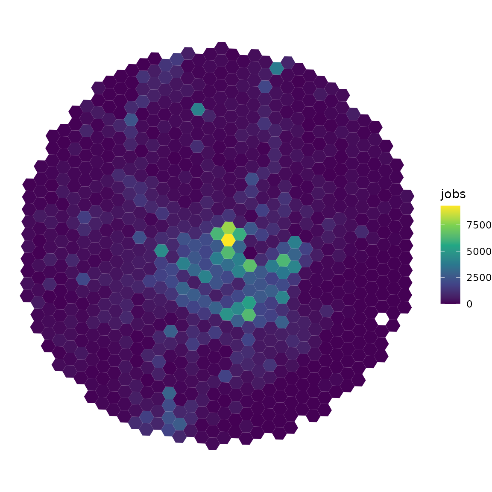
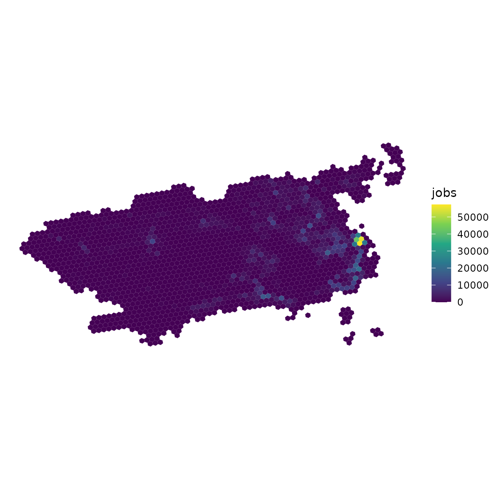

# Introduction to uci: urban centrality index

**uci** is an `R` package to measure the centrality of cities and
regions. The package implements the Urban Centrality Index (UCI)
originally proposed by Pereira et al. (2013). UCI measures the extent to
which the spatial organization of a city varies from extreme monocentric
to extreme polycentric in a continuous scale, rather than considering a
binary classification (*either* monocentric *or* polycentric). UCI
values range from 0 to 1. Values closer to 0 indicate more polycentric
patterns and values closer to 1 indicate a more monocentric urban form.

## Installation

``` r

# from CRAN
install.packages('uci')

# development version from GitHub
remotes::install_github("ipea/uci")
```

## Demonstration on sample data

First, let’s load a few libraries we’ll be using in this vignette.

``` r

library(uci)
library(sf)
```

``` r

library(ggplot2)
```

### Data input

The **uci** package comes with a sample data for demonstration and test
purposes. The data is a small sample of the spatial distribution of the
population, jobs and schools around the city center of Belo Horizonte,
Brazil. This sample data set is a good illustration of the type of data
input required by **uci**.

Here is how the sample data looks like:

``` r

data_dir <- system.file("extdata", package = "uci")

grid <- readRDS(file.path(data_dir, "grid_bho.rds"))
head(grid)
#> Simple feature collection with 6 features and 4 fields
#> Geometry type: POLYGON
#> Dimension:     XY
#> Bounding box:  xmin: -43.96438 ymin: -19.97414 xmax: -43.93284 ymax: -19.96717
#> Geodetic CRS:  WGS 84
#>                id population jobs schools                       geometry
#> 1 89a881a5a2bffff        439  180       0 POLYGON ((-43.9431 -19.9741...
#> 2 89a881a5a2fffff        266  134       0 POLYGON ((-43.94612 -19.972...
#> 3 89a881a5a67ffff       1069  143       0 POLYGON ((-43.94001 -19.972...
#> 4 89a881a5a6bffff        245   61       0 POLYGON ((-43.9339 -19.9728...
#> 5 89a881a5a6fffff        298   11       0 POLYGON ((-43.93691 -19.971...
#> 6 89a881a5b03ffff        555 1071       0 POLYGON ((-43.96136 -19.970...
```

The data is an object of class `"sf" "data.frame"` with spatial polygons
covering our study area and a few columns indicating the number of
activities (e.g. jobs, schools, population) in each polygon. Our
particular sample data is based on a spatial hexagonal grid (H3 index).
While there are advantages of using regular spatial grids to calculate
spatial statistics, **uci** also works with non-regular geometries, such
as census tracts, enumeration areas or municipalities.

We can visualize the spatial distribution of jobs using `ggplot2`:

``` r


ggplot(data = grid) +
  geom_sf(aes(fill = jobs), color = NA) +
  scale_fill_viridis_c() +
  theme_void()
```



### Calculating UCI

In the example below, we calculate how mono/polycentric our study area
is considering its spatial distribution of jobs.

``` r

df <- uci(
  sf_object = grid,
  var_name = 'jobs', 
  dist_type = 'euclidean'
  )

head(df)
#>         UCI location_coef spatial_separation spatial_separation_max
#> 1 0.2538635     0.5278007           3880.114               7475.899
```

By default, the [`uci()`](https://ipea.github.io/uci/reference/uci.md)
function uses Euclidean distances between polygons. However, Euclidean
distances can lead to misleading results in the case of areas with a
concave shape (like a bay). In these cases, it is strongly recommended
to use `dist_type = 'spatial_link'`. These spatial link distances
consider Euclidean distances along the links of spatial neighbour links.
This is a bit more costly computationally speaking, but it does return
more realistic results.

Mind you, though, that when using `"spatial_link"` distances, there
should be no disconnected island of polygon (or group of polygons). In
some cases, users might need to manually edit their spatial data to
include a polygon representing a road or bridge connecting disconnected
parts of the area.

``` r

df <- uci(
  sf_object = grid,
  var_name = 'jobs', 
  dist_type = 'spatial_link'
  )

head(df)
#>         UCI location_coef spatial_separation spatial_separation_max
#> 1 0.2535891     0.5278007           4281.819               8241.617
```

The package also includes a larger and more irregular sample data set,
`grid_rio.rds`. It covers the municipality of Rio de Janeiro, Brazil,
with a concave outline around the Guanabara and Sepetiba bays and
several islands, including single isolated cells. The data comes from
the [Access to Opportunities
Project](https://www.ipea.gov.br/acessooportunidades/en/) (AOP, Ipea,
2019), aggregated to H3 resolution 8. Because of its islands, the full
grid only works with `dist_type = 'euclidean'`:

``` r

grid_rio <- readRDS(file.path(data_dir, "grid_rio.rds"))
```

``` r

ggplot(data = grid_rio) +
  geom_sf(aes(fill = jobs), color = NA) +
  scale_fill_viridis_c() +
  theme_void()
```



As you can see, the case of Rio include a few islands disconnected from
mainland. In this case, the user has two options. One of them is using
`dist_type = 'euclidean'`.

``` r


df <- uci(
  sf_object = grid_rio,
  var_name = 'jobs',
  dist_type = 'euclidean'
  )

df
#>         UCI location_coef spatial_separation spatial_separation_max
#> 1 0.3297768      0.693971           17632.32               33598.34
```

Alternatively, you use `dist_type = 'spatial_link'` and pass
`remove_islands = TRUE`. In this case,
[`uci()`](https://ipea.github.io/uci/reference/uci.md) drops the islands
calculates UCI only for the largest group of neighbouring polygons:

``` r

df <- uci(
  sf_object = grid_rio,
  var_name = 'jobs',
  dist_type = 'spatial_link',
  remove_islands = TRUE
  )
#> Removed 44 polygons (255 jobs) outside the largest contiguous area of
#> `sf_object`.

df
#>         UCI location_coef spatial_separation spatial_separation_max
#> 1 0.3166672     0.6894746           19331.93               35752.71
```

To see which polygons are dropped before calculating UCI, use the
function
[`remove_islands()`](https://ipea.github.io/uci/reference/remove_islands.md).
It returns the `sf` object with only the largest group of neighbouring
polygons, which you can map and then pass to
[`uci()`](https://ipea.github.io/uci/reference/uci.md).

### Formal definition of UCI

The **Urban Centrality Index (UCI)** is given by the product of the
Location Coefficient (LC) and the Proximity Index (PI). With this
formulation, UCI calculates urban centrality simultaneously accounting
for both the *concentration* of activities and the *proximity* between
activities.

``` math
\begin{aligned}
UCI = LC  * PI
\end{aligned}
```
The **Location Coefficient (LC)** was introduced by Florence (1948) to
measure the unequal distribution factor of jobs within an urban area. It
works as *a nonspatial inequality measure* (similarly to Gini, for
example). It reflects, for example, the extent to which the number of
activities are concentrated in few polygons. The range of the LC is `0`
to `(1 - 1/n)`. If LC equals zero, then economic activity is evenly
distributed, while values close to `(1 - 1/n)` indicate that employment
is concentrated in a few areas.

``` math
\begin{aligned}
LC = \frac{1}{2} \sum_{1}^{n}∣S_{i} − \frac{1}{n}​|\\  
S_{i} = \frac{E_{i}}{E}
\end{aligned}
```

where `Si` is the share of employment in area i (Ei) relative to the
total employment (E) of the city; E is the total number of jobs in a
city; and n = number of areas.

Meanwhile, the **Proximity Index (PI)** is a transformation that Pereira
et al. (2013) proposed for the Venables index, originally developed by
Midelfart-Knarvik et al. (2002) to examine changes in the spatial
distribution of economic activity. The Venables index (*aka* spatial
separation index) is defined as:

``` math
\begin{aligned}
V = S' * D * S  
\end{aligned}
```
where `S` is a column vector of `Si`; and `D` is a distance matrix whose
entry `dij` is the distance between the centroids of areas i and j.

When all employment activity is concentrated in just one spatial unit,
the minimum value of `V` is reached; that is, zero (no matter where this
spatial unit is located). However, the index has no *maximum* value and
therefore cannot be compared across different spatial settings. To
overcome this limitation, it is necessary to calculate the maximum
attainable value of `V`.

The **Proximity Index (PI)** solves the normalization issue with `V` and
changes its interpretation to suit our needs. The interpretation of PI
is the opposite of `V`, with its theoretical range being `(0, 1)`.
Values of PI closer to `1` mean that employment is clustered in one
single center. If PI is `0`, employment is as spatially separated as
possible. In other words, activities are distributed in a way that
maximizes the distances between them.

``` math
\begin{aligned}
P = 1 - \frac{V}{V_{max}}
\end{aligned}
```

The normalization by `Vmax` is what makes the comparison of urban areas
of different shapes and sizes possible. However, the estimation of
`Vmax` is not trivial, because it has no closed-form solution. In a very
simple square grid, `Vmax` is obtained when each corner has one-fourth
of the total employment. In a region forming a perfect circle, the
maximum value of V occurs when all employment is evenly distributed
along the external edge.

In the original paper, Pereira et al. (2013) proposed a simple heuristic
approach to calculate `Vmax`(the “opposite of maximum proximity”) as a
homogeneous distribution of values along the edge of the study area.
This is the default strategy used in the
[`uci()`](https://ipea.github.io/uci/reference/uci.md) function with the
default parameter `bootstrap_border = FALSE`. Nonetheless, the users can
also use a bootstrap simulation approach to estimate `Vmax` by setting
`bootstrap_border = TRUE`.

#### Bootstraping `Vmax`

Using bootstrap to find max Venables spatial separation. With
`dist_type = "spatial_link"`, users can set `parallel = TRUE` to compute
shortest-path distances using several threads.

``` r

df_bootstrap <- uci(
  sf_object = grid,
  var_name = 'jobs',
  bootstrap_border = TRUE,
  showProgress = FALSE
)

head(df_bootstrap)
#>         UCI location_coef spatial_separation spatial_separation_max
#> 1 0.2553067     0.5278007           3880.114               7515.494
```

This bootstrap approach simulates 20000 random distributions of
activities along the border. It practice, it works interacting two
simulations: (1) it simulates that all jobs are concentrated in up to 2,
3, 4, 5 … 51 polygons along the border, and (2) for each number of
selected polygons, it shuffles 400 random positions of those polygons
along the border.

The bootstrap approach is more computationally expensive but it returns
`Vmax` values that can be between 5 and 25% higher than the heuristic
approach. Although the bootstrap simulation might still not return the
maximum theoretical value of spatial separation, it is probably very
close to it

## References

Florence, Philip Sargant. 1948. *Investment, Location and Size of Plant:
A Realistic Enquiry into the Structure of British and American
Industries*. Vol. 8. CUP Archive.

Midelfart-Knarvik, Karen Helen, Henry G. Overman, Stephen Redding, and
Anthony J. Venables. 2002. “Integration and Industrial Specialisation in
the European Union.” *Revue Économique* 53 (3): 469–81.
<https://doi.org/10.2307/3502978>.

Pereira, Rafael H. M., Vanessa Nadalin, Leonardo Monasterio, and Pedro
H. M. Albuquerque. 2013. “Urban Centrality: A Simple Index.”
*Geographical Analysis* 45 (1): 77–89.
<https://doi.org/10.1111/gean.12002>.
